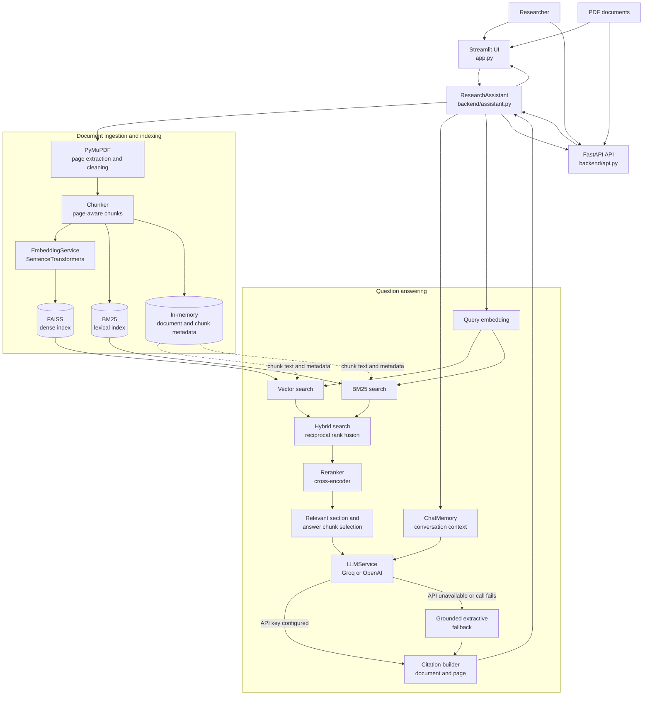
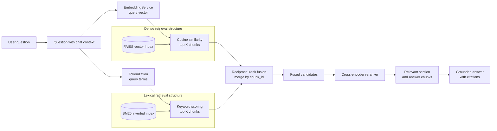

# Intelligent PDF Research Assistant using Hybrid Retrieval-Augmented Generation

## 1. Project title

Intelligent PDF Research Assistant using Hybrid Retrieval-Augmented Generation

## 2. Problem statement

Academic and research workflows often involve large PDF collections that contain important findings, methods, and datasets spread across many pages. Static keyword search is often insufficient because semantics and domain vocabulary vary. At the same time, pure semantic retrieval can miss exact terms that matter for precise evidence lookup. A robust pipeline should combine lexical retrieval, dense semantic retrieval, reranking, and grounded generation so that answers are supported by specific document evidence rather than unsupported model guesses.

## 3. Objectives

- Upload one or more PDF documents and build a retrieval index locally.
- Extract page-aware text from PDFs and split it into manageable chunks.
- Combine BM25, dense vector retrieval, and reciprocal rank fusion for hybrid retrieval.
- Rerank candidate chunks with a cross-encoder before passing them to an LLM.
- Generate grounded answers with explicit page-level citations from the source documents.
- Generate document-wide summaries when the user asks for a summary, overview, or key points.
- Provide a research-oriented evaluation framework to compare retrieval methods.

## 4. Features

- PDF ingestion with page-level text extraction.
- Chunking with configurable chunk size and overlap.
- FAISS vector store for dense semantic search.
- BM25 keyword retrieval using rank_bm25.
- RRF hybrid fusion of dense and BM25 rankings.
- Cross-encoder reranking for candidate refinement.
- Streamlit chat interface with session memory.
- FastAPI backend for processing and retrieval endpoints.
- Multi-document management with per-document statistics.
- Evaluation module that compares BM25, vector, hybrid, and hybrid+rerank retrieval.

## 5. Architecture

The Streamlit UI and FastAPI service both use the same in-memory `ResearchAssistant`. Uploaded PDFs are processed into page-aware chunks and indexed for dense and lexical retrieval. Questions use hybrid retrieval by default, followed by reranking and grounded answer generation.
Summary requests are detected by the dedicated `backend/summarization.py` module and use
document-ordered chunks directly, so they do not fail because a summary request has no
single question/answer section to retrieve.



### Runtime flows

- **Upload:** UI/API -> `ResearchAssistant.add_document()` -> PDF extraction -> chunking -> embedding + FAISS indexing and BM25 indexing.
- **Ask:** UI/API -> query embedding -> vector and/or BM25 retrieval -> reciprocal rank fusion -> cross-encoder reranking -> relevant context selection -> LLM or grounded extractive fallback -> page citations.
- **State:** indexes, document metadata, chunks, and chat history live in process memory and are cleared by the document-clear operation or process restart.

### Hybrid retrieval workflow

The hybrid mode uses two retrieval structures in parallel. Dense retrieval handles semantic similarity, while BM25 handles exact words and technical terms. Reciprocal rank fusion combines both ranked lists before reranking.



**Hybrid path:** `question -> vector search + BM25 search -> reciprocal rank fusion -> cross-encoder reranking -> context selection -> LLM/fallback answer`.

## 6. Technology stack

- Python 3.11+
- FastAPI for backend services
- Streamlit for frontend UI
- PyMuPDF (fitz) for PDF extraction
- SentenceTransformers for embeddings and reranking
- FAISS for vector indexing
- rank_bm25 for BM25 retrieval
- Optional Groq or OpenAI-compatible LLM provider via environment variables

## 7. Installation

```bash
python -m venv .venv
source .venv/bin/activate   # Linux/macOS
# or .venv\Scripts\activate   # Windows
pip install -r requirements.txt
cp .env.example .env
```

The query-understanding layer uses the NLTK WordNet vocabulary for
POS-aware synonym expansion. Download its data once after installation:

```bash
python -m nltk.downloader wordnet omw-1.4
```

If WordNet data is not installed, retrieval continues with the built-in
high-confidence paraphrases and dense embedding search.

## 8. Environment variables

The project reads configuration from environment variables. A template is included in `.env.example`.

```env
LLM_PROVIDER=groq
LLM_MODEL=llama-3.3-70b-versatile
GROQ_API_KEY=your_groq_api_key_here
GROQ_MODEL=llama-3.3-70b-versatile
OPENAI_API_KEY=
OPENAI_MODEL=gpt-4.1
EMBEDDING_MODEL=BAAI/bge-small-en-v1.5
RERANKER_MODEL=cross-encoder/ms-marco-MiniLM-L-6-v2
API_PORT=8000
```

If no API key is configured, the system falls back to a grounded local answer generation strategy that uses the retrieved document context.

For the supplied question-bank PDF, use `Hybrid Search` with 20 retrieval results and 15 reranked results. The interface supports Groq models `llama-3.3-70b-versatile` and `llama-3.1-8b-instant`, and OpenAI models `gpt-4.1`, `gpt-4o`, and `gpt-4o-mini`. Larger models generally produce better summaries; retrieval quality still depends on having the PDF indexed and an API key configured.

## 9. How to run

Start the API backend:

```bash
uvicorn backend.api:app --host 0.0.0.0 --port 8000
```

Start the Streamlit app:

```bash
streamlit run app.py
```

## 10. Example usage

1. Upload a PDF from the sidebar.
2. Wait for the processing pipeline to finish.
3. Ask a question such as:
   - What is the main methodology used in the paper?
   - What dataset was used?
   - How does the system combine semantic and lexical retrieval?
4. Review the answer with source pages and context snippets.

## 11. Evaluation methodology

The evaluation module runs actual retrieval experiments on a prepared set of sample questions and a generated research-oriented PDF.

The script compares:

- BM25
- Vector search
- Hybrid search
- Hybrid + reranker

Metrics computed include:

- Recall@K
- Precision@K
- MRR
- retrieval latency

To run the evaluation:

```bash
python evaluation/evaluate_retrieval.py
```

## 12. Limitations

- Retrieval and answer quality depend heavily on PDF text extraction quality.
- Scanned PDFs without recognizable text may fail or produce weak evidence.
- Local LLM availability and model performance depend on the configured provider and API limits.
- The evaluation dataset is intentionally compact and suitable for demonstration rather than large-scale benchmarking.

## 13. Future scope

- Add user authentication and persistent document storage.
- Support PDF OCR for scanned academic documents.
- Add query reformulation and multi-turn summarization.
- Extend evaluation to larger corpora and enterprise research collections.
- Support structured extraction for tables, figures, and citations.

## 14. Research methodology

This project is designed to support a final-year software engineering research study on the question:

"How does combining semantic retrieval, keyword retrieval, reciprocal rank fusion, and cross-encoder reranking affect the retrieval quality of PDF question-answering systems?"

The contribution is experimental and empirical: the system compares several retrieval pipelines under the same document corpus and question set. The evaluation demonstrates the behavior of hybrid retrieval with and without reranking, highlighting how each stage contributes to quality and efficiency.

## 15. References

- Robertson, S. E., & Zaragoza, H. (2009). The probabilistic relevance framework: BM25 and beyond. Foundations and Trends in Information Retrieval.
- Karpukhin, V., et al. (2020). Dense Passage Retrieval for Open-Domain Question Answering.
- Nogueira, R., & Cho, K. (2019). Passage Re-ranking with BERT.
- Reimers, N., & Gurevych, I. (2019). Sentence-BERT: Sentence Embeddings using Siamese BERT-Networks.
- Lewis, P., et al. (2020). Retrieval-Augmented Generation for Knowledge-Intensive NLP Tasks.
- SentenceTransformers documentation for embedding and reranking models.
- FAISS documentation for nearest-neighbor vector search.
- Groq and OpenAI API documentation for hosted LLM inference.

## 16. Notes

This project is an independently implemented research assistant for local PDF analysis and experimental retrieval comparison. It does not claim to be based on or copied from a specific GitHub repository.
